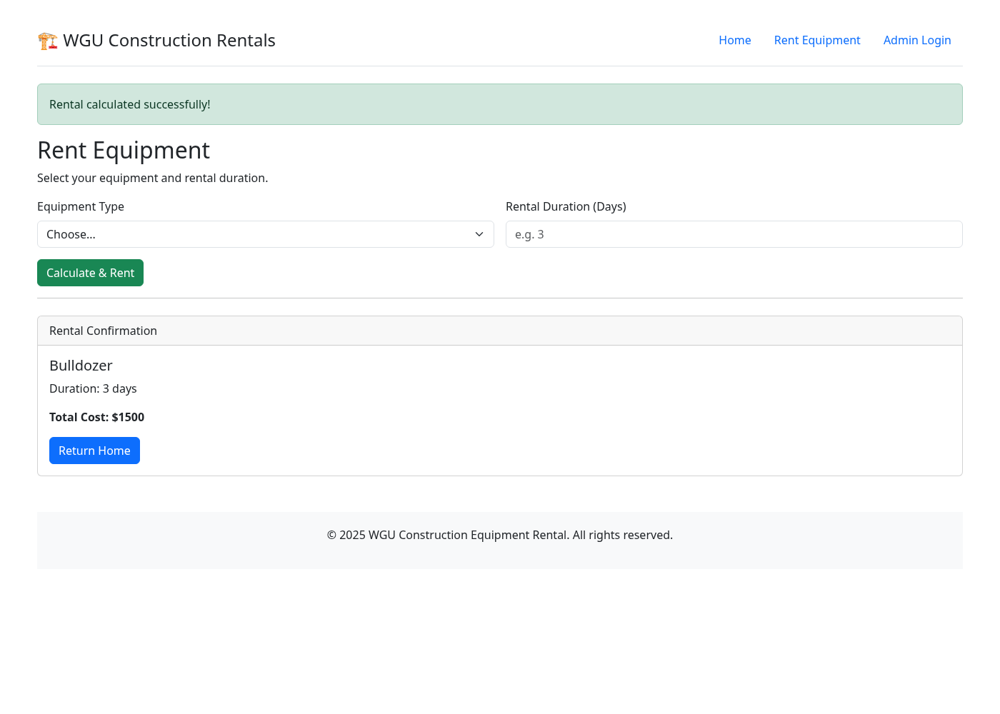
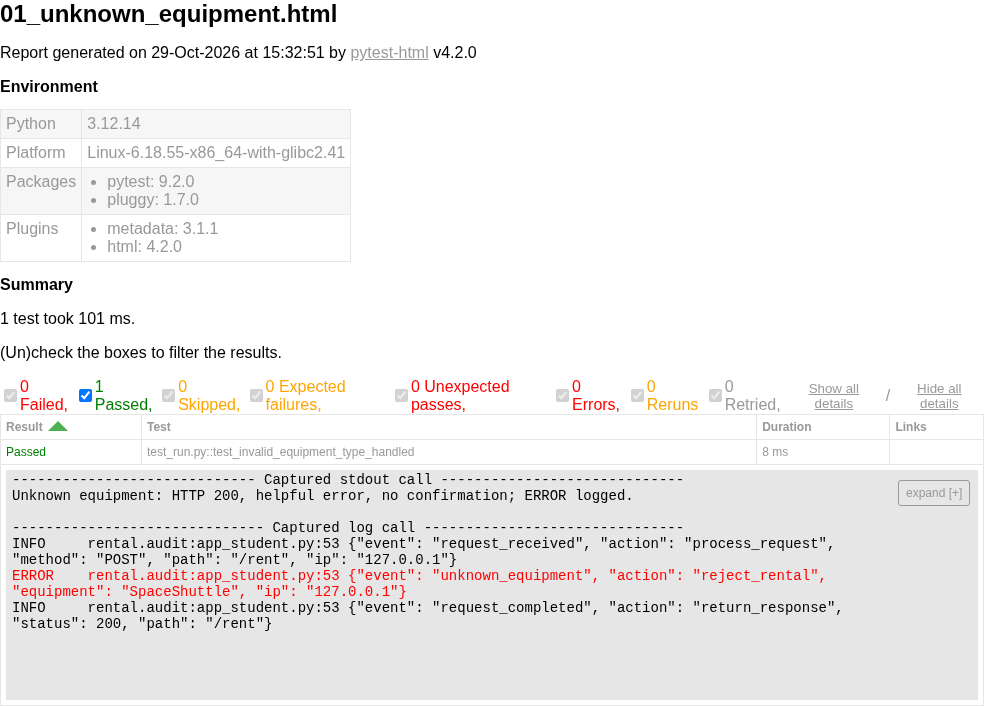
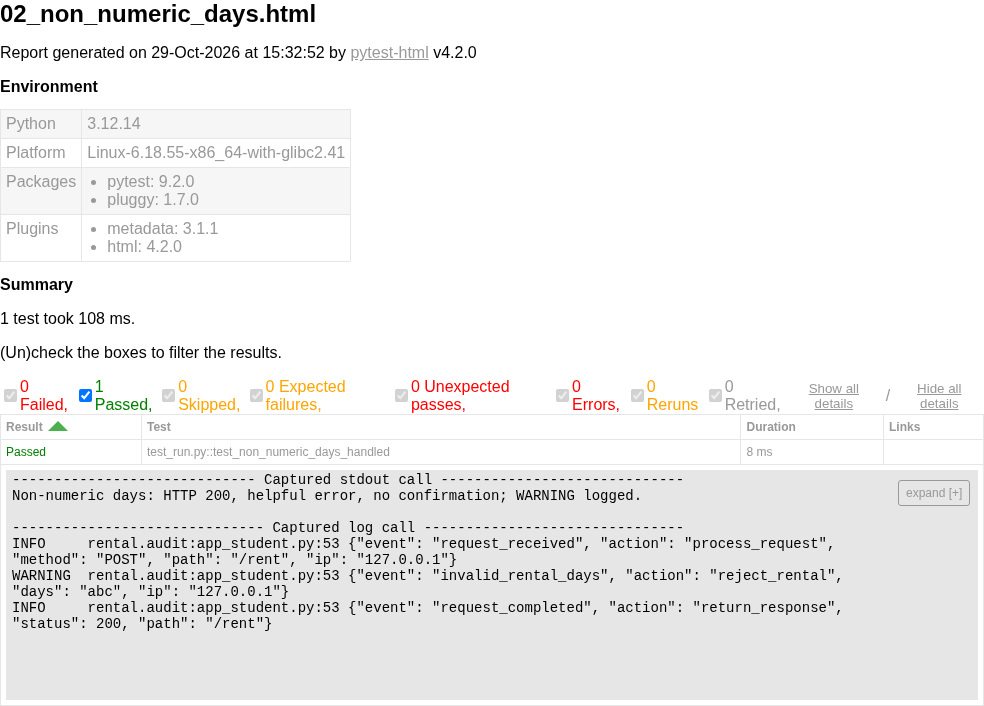
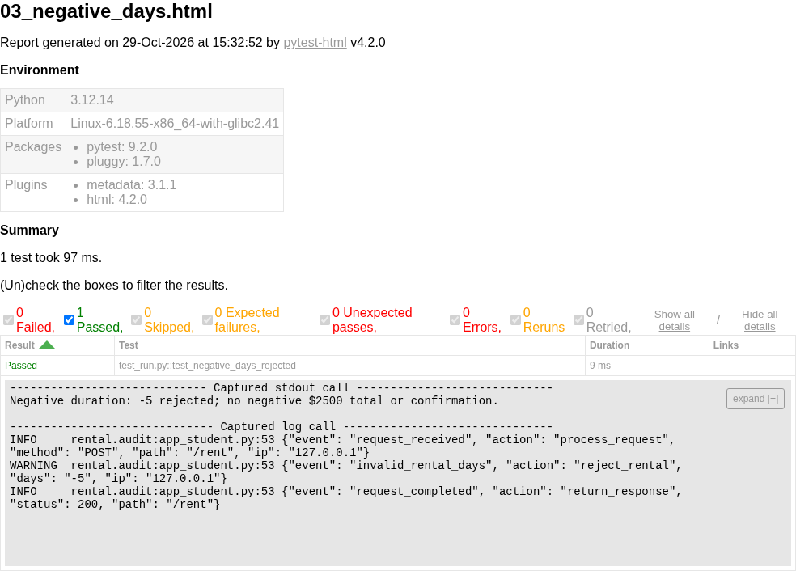
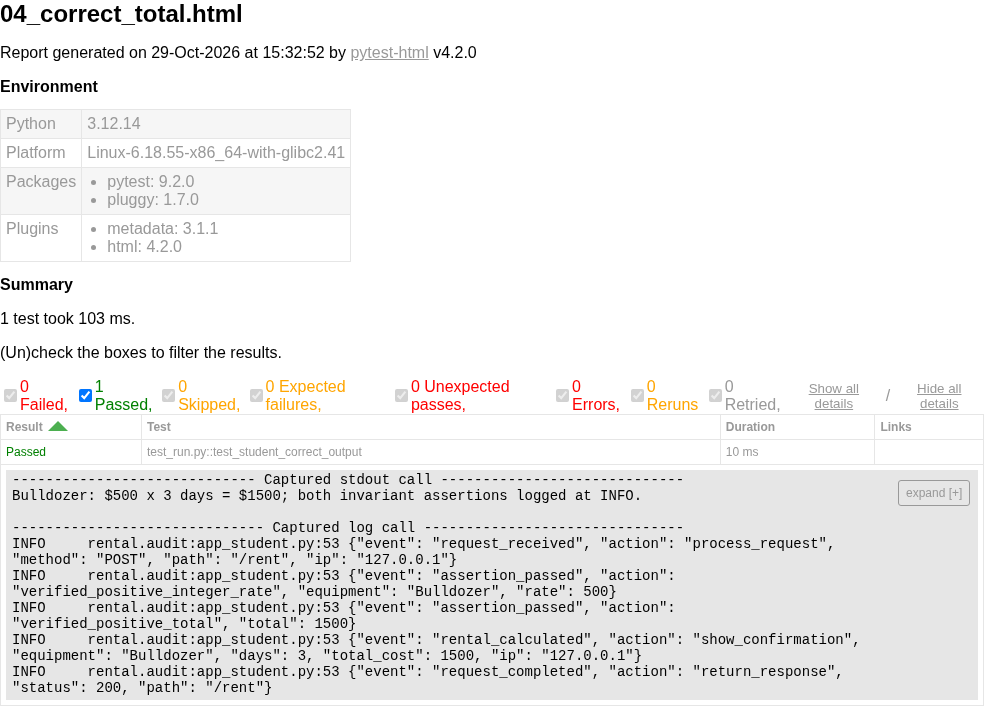

# Software Security and Testing: Construction Equipment Rental Application

Student ID: 9925673  
WGU D385 • Task 1  
Prepared October 29, 2026

## Scope and evidence

This report documents a manual review, corrective implementation, and executed tests of the supplied Flask starter application (Western Governors University [WGU], n.d.). The original archive was extracted and retained separately; changes were made in the submission/application folder. Instructions and sample claims inside the starter were treated as reference material. The assignment supplied in the user's request determines the scope of this report.

The environment used Python 3.12.14, Flask 3.1.3, pytest 9.2.0, Bandit 1.9.4, and Flake8 7.5.0 on Linux. Thirty updated test cases passed, with no failures or skips. A live Chromium browser also submitted a rental form to the running Flask server and verified a $1,500 confirmation. Screenshots are real captures of the application and pytest-html results. They are not screenshots of Visual Studio Code. VS Code is unavailable in this cloud environment; WGU-Rental.code-workspace is supplied for opening the application locally. That local IDE step remains to be performed by the student.

## A. Static analysis and manual review

### A1. Purpose and role of static code analysis

Static code analysis examines source code without running the application. Manual inspection and automated tools can identify risky patterns, questionable data flows, and coding defects before release. In a secure development workflow, static analysis provides early feedback during coding and continuous integration, allowing developers to correct problems before they become runtime incidents. Its findings must be reviewed: a warning can be a false positive, and a clean scan does not prove that software is secure. Runtime tests, dependency review, and contextual security review remain necessary (OWASP Foundation, n.d.-a).

### A2. Five types of issues static analysis can detect

1. Security-sensitive coding patterns. Tools can flag embedded secrets, unsafe command construction, dangerous APIs, and potential injection paths. Detection depends on the rules and data-flow analysis available. In this application, Bandit detected the hardcoded Flask secret and password.

2. Potential runtime and type errors. Analysis can identify undefined variables, inconsistent return types, dereferences of possibly absent values, and unchecked operations. A dictionary lookup or numeric conversion involving user input deserves review even when a particular tool does not report it.

3. Logic and control-flow defects. Unreachable branches, missing return paths, incorrect conditions, and some resource-handling mistakes can be discovered statically. Business constraints, such as requiring positive rental days, often require domain-aware manual review.

4. Unused or incomplete code. Unused imports and variables, dead assignments, and duplicate code reduce clarity and can reveal unfinished functionality. The starter's unused ip_address variable indicates that its planned monitoring was not implemented.

5. Style and maintainability violations. Line length, indentation, whitespace, naming, and excessive complexity affect reviewability and maintenance. Flake8 identifies many such issues. A style warning is not automatically a security vulnerability, but clear code makes security defects easier to find (OWASP Foundation, n.d.-a).

### A3. Five distinct manual-review findings

1. Unhandled equipment lookup. The original rent_equipment function indexes EQUIPMENT_PRICES using the submitted equipment_type. An unavailable value such as SpaceShuttle raises KeyError. Missing equipment has the same failure path. The baseline test reproduced this exception. The update catches KeyError, records an ERROR event named unknown_equipment, and redisplays the form without a confirmation.

2. Unhandled duration conversion. The original int(days_str) raises ValueError for abc and can raise TypeError when the field is absent. The baseline nonnumeric test failed with ValueError. The update validates presence, type, ASCII integer syntax, and length before conversion; invalid duration input raises a controlled ValueError, is caught, and produces a WARNING.

3. Missing rental-duration bounds. The original multiplication accepts negative days and calculates a negative charge. The baseline test reproduced a Bulldozer rental of -5 days totaling $-2500. The update accepts only 1–365 days, using explicit checks before the calculation. HTML min/max attributes improve usability but are not relied on for server security.

4. Hardcoded session secret and password. Both the session-signing key and the shared password are visible in the starter. Knowledge of a session key threatens session integrity; an embedded password compromises credential confidentiality. The update uses a configured session key or a cryptographically random per-process key and verifies a Werkzeug password hash configured outside source code. Demo login is disabled when no hash is configured. Werkzeug's password helpers use a purpose-built password derivation function rather than an unsalted general-purpose digest (Pallets Projects, n.d.-b).

5. Missing persistent audit trail. The starter prints messages, contains no logging configuration, and never uses the assigned client IP. Failures and suspicious patterns therefore cannot be reliably correlated in a new log. The update writes structured request, response, validation, calculation, and login events with timestamp, action, event, and severity. It also observes addresses outside the configured local networks. Passwords are never logged; untrusted values are bounded and JSON-escaped to reduce log-forgery risk (OWASP Foundation, n.d.-b).

The supplied validate_username docstring claims the function accepts almost anything, but the original implementation actually checks membership in a four-user allowlist. This report does not repeat that inaccurate claim. The revised helper additionally handles non-string inputs safely.

## B. Implementation and test evidence

### B1. File logging

The application writes Troubleshooting_9925673.log beside app_student.py. The literal studentID placeholder was replaced with the supplied student ID. A dedicated INFO-level logger and RotatingFileHandler capture INFO, WARNING, and ERROR records immediately. Each record includes a UTC timestamp ending in Z, severity, and a JSON object containing event and action. Rotation is limited to a 1 MB current file plus three backups, reducing the risk of unbounded growth. Handler flushing makes emitted records available for inspection; this does not claim crash-proof disk durability (Python Software Foundation, n.d.-b).

Example structure from the generated log:

```text
2026-10-29T15:26:17Z - ERROR - {"event": "unknown_equipment", "action": "reject_rental", "equipment": "SpaceShuttle", "ip": "127.0.0.1"}
2026-10-29T15:26:17Z - WARNING - {"event": "invalid_rental_days", "action": "reject_rental", "days": "abc", "ip": "127.0.0.1"}
```

The timestamps above identify actual captured entries in the supplied log. Log timestamps are UTC to aid correlation; the report date is October 29, 2026 in the user's America/Chicago timezone.

### B2. Two expected runtime errors

The try block in rent_equipment calls calculate_rental_cost. Its KeyError handler logs ERROR/unknown_equipment and flashes “Please choose available equipment.” Its ValueError handler logs WARNING/invalid_rental_days and flashes the allowed duration range. The form is redisplayed with HTTP 200 to preserve the supplied tests' interface contract. Neither rejected request produces a rental confirmation. These are handled request failures, not uncaught server crashes.

### B3. Two assertions and successful INFO records

The calculation includes two explicit assert statements: assert isinstance(daily_rate, int) and daily_rate > 0, and assert total_cost > 0. A successful first assertion is followed by INFO/assertion_passed with action verified_positive_integer_rate; the second is followed by INFO/assertion_passed with action verified_positive_total. The correct-output test checks for both actions, and a separate log-level test verifies that a fresh successful request emits exactly two INFO assertion records.

Assertions are developer checks of internal assumptions, not the enforcement mechanism for user input. Python removes assertions in optimized mode. Explicit duration and pricing checks remain active independently, and test_validation_survives_optimized_python verifies that abc, 0, and -5 remain rejected under python -O (Python Software Foundation, n.d.-a). INFO messages describe the validated invariants; in optimized execution the assert statements themselves are omitted.

### B4. Application running

Figure 1 captures the live Flask application after Chromium submitted Bulldozer for three days. The browser received a Rental Confirmation with Total Cost: $1500. The application was running with debug disabled and bound to loopback on port 5000. Bootstrap 5.3.0 assets are bundled locally because the browser could not load the external CDN stylesheet during initial validation. Original home-page stock photos still depend on their external image host; they are not needed for calculation or testing.



### B5. Four unique passed tests

The following screenshots capture four separate, actual pytest runs. Each reports one passed test and displays captured output. The original HTML reports and stdout files are included in evidence/ for independent inspection. The screenshots do not simulate terminal output or an IDE.

#### Figure 2. Unknown equipment handled

Test: test_invalid_equipment_type_handled. Input: SpaceShuttle, three days. Assertions verify HTTP 200, a helpful equipment error, no Rental Confirmation, and an unknown_equipment event. Result: 1 passed.



#### Figure 3. Nonnumeric duration handled

Test: test_non_numeric_days_handled. Input: Bulldozer, abc days. Assertions verify HTTP 200, the duration validation message, no Rental Confirmation, and an invalid_rental_days event. Result: 1 passed.



#### Figure 4. Negative duration rejected

Test: test_negative_days_rejected. Input: Bulldozer, -5 days. Assertions verify HTTP 200, the range error, absence of -2500, and absence of a rental confirmation. Result: 1 passed.



#### Figure 5. Correct result and assertion evidence

Test: test_student_correct_output. Input: Bulldozer, three days. Assertions verify HTTP 200, a confirmation, Duration: 3 days, Total Cost: $1500, and both invariant-success actions in the log. Result: 1 passed.



The full updated suite reports 30 passed, zero failed, and zero skipped. It additionally covers username validation, missing fields, duration boundaries, other equipment calculations, configured and disabled login, IP monitoring, forged forwarding headers, log injection, security headers, request size, and validation under optimized Python. The original three regression checks produced 3 failed before fixes. The starter's three student tests contained only pass; these placeholders were replaced with real assertions and are not counted as meaningful baseline successes.

## C. Log analysis, debugging, and defensive coding

### C1a. How the generated log reveals issues

Correlating request_received, validation events, and request_completed shows whether an abnormal input was handled and how the application responded. For example, an unknown_equipment ERROR followed by request_completed/status 200 means the form recovered and returned a handled error; severity alone does not mean the application crashed. Successful requests emit calculation and assertion records, making the expected path observable. File-based records preserve diagnostic context after a request finishes, unlike transient print output (OWASP Foundation, n.d.-b; Python Software Foundation, n.d.-b).

The current log contains controlled test traffic and browser validation, not production incidents. Test-client requests can simulate addresses, so those entries demonstrate monitoring behavior rather than proving an actual external attack. All quoted events and the analysis apply to the submitted log snapshot; additional runs append new records.

### C1b. Two abnormal patterns and findings

Example 1 — malformed and boundary-value rental requests. The generated log records invalid_rental_days for abc, -5, zero, absent fields, and values above 365, as well as unknown_equipment for unavailable catalog entries. Repetition and changing invalid values would justify investigating client bugs, scripted probing, or fuzzing in a deployed service. Here these were intentionally generated regression cases. Finding: the revised application rejected these inputs, avoided confirmations, and continued processing. The historical network_security_log.txt similarly reports abc on December 16 and Forklift on December 17, supporting prioritization of these checks.

Example 2 — requests outside the expected local networks. The generated log records WARNING/untrusted_network for a test request with REMOTE_ADDR set to 203.0.113.45, followed by normal response processing. Finding: the new monitoring makes this address visible but deliberately does not equate external access with malicious intent or claim it was blocked. The supplied historical log records a burst from that address at 10:22:15–10:22:20 on December 19, 2025, labeled as six attempts in five seconds, followed by a blocklist entry. The address reappears on December 20. Such clustering and recurrence would warrant investigation of password guessing and blocklist enforcement. This starter has no real blocklist service, and this update does not claim to implement one.

Historical log claims must be interpreted carefully. The supplied file mentions a database connection timeout and a calculate_rental_cost division-by-zero crash. The original source has no database integration and multiplies price by days without division; these particular claims cannot be reproduced from the starter. Strings such as DropTable and a script tag indicate suspicious input in the supplied log, but do not by themselves establish successful SQL injection or XSS. The starter has no SQL queries, and its Jinja templates retain default escaping. The sample addresses 203.0.113.45 and 198.51.100.23 belong to documentation ranges, consistent with an illustrative training log.

### C2a. Debugging techniques used

Debugging began with manual tracing from request.form through dictionary lookup, conversion, and multiplication. Running the original three provided tests reproduced the two exceptions and negative total. Their tracebacks pinpointed the failing lookup and conversion. The correction separated calculation from the route, allowing focused helper tests and HTTP-level regression checks.

After each correction, pytest exercised the relevant input path. Log records connected submitted values with the chosen exception handler and response. A live browser test then checked that the rendered form actually produced the expected confirmation. No VS Code breakpoint, interactive stepping session, or graphical debugger was used; the techniques actually used were source tracing, exception tracebacks, targeted tests, and log inspection. Raw commands, return codes, and results are retained under evidence/.

### C2b. Defect and corrective fix for each test screenshot

Figure 2: The defect was an unchecked pricing dictionary lookup. The fix catches KeyError, logs an ERROR with a bounded equipment value and IP, flashes a safe error, and omits the confirmation. The screenshot verifies the recovered request.

Figure 3: The defect was unguarded conversion of unrestricted duration text. The fix validates format and bounds, then catches ValueError and logs a WARNING. The screenshot confirms abc is handled rather than causing a server exception.

Figure 4: The defect was allowing a negative duration to generate a negative cost. The fix enforces a positive 1–365-day domain before multiplication. The screenshot verifies rejection of -5 and absence of the original -2500 charge.

Figure 5: The defect was missing verification and persistent diagnostic evidence for calculation assumptions. The original three-day calculation was arithmetically correct; this report does not invent an arithmetic error. The fix adds explicit internal pricing/total checks, two required assertions, and INFO records following success. The screenshot verifies that the correct $1500 behavior is preserved while both invariant events are captured.

### C3. Defensive coding and remaining limits

Input validation uses an equipment allowlist, bounded ASCII duration syntax, explicit 1–365 limits, and a username type/length/allowlist check. Request bodies are capped at 16 KB. These checks operate server-side; browser form constraints alone cannot prevent crafted requests. Specific exception handlers recover from two anticipated request errors without concealing all programming errors behind a broad except block.

Assertions document internal invariants after explicit validation. They are accompanied by INFO records for observability and are not relied upon as security boundaries. A dedicated test proves that disabling assertions does not disable duration validation. Structured log escaping prevents a submitted newline from becoming a forged additional record, and passwords are excluded from logs. The request IP is taken from the actual connection, not an arbitrary X-Forwarded-For header.

The hardcoded credentials were removed. By default, rental calculation works without credentials and login returns a configuration message with HTTP 503. The optional launch_demo.py prompts locally for a temporary password, stores only its derived hash in process configuration, and enables the demonstration login. Tests verify configured successful and failed login. A supplied stable FLASK_SECRET_KEY can preserve session signing across restarts; the random fallback is for a single local process. This application remains a teaching calculator: it does not persist rentals, create authenticated authorization sessions, or implement real user accounts.

Production hardening remains outside the completed demonstration. Before deployment, add per-account password storage, authorization, CSRF controls, rate limiting, trusted reverse-proxy configuration, HTTPS with secure cookies, centralized monitoring and protected log retention, and a production WSGI server. The current IP warning is observability, not an access-control policy. These limitations prevent describing the result as production-secure (Pallets Projects, n.d.-a).

### C4. Static analysis results and limits

Fresh Bandit and Flake8 runs were executed rather than relying on the supplied static_analysis_report.txt. The original Bandit run found two B105 hardcoded-password warnings. The revised scan no longer reports B105, but returns two B101 warnings for the assignment-required assertions. These warnings remain visible and were not suppressed. They were reviewed against explicit validation and the optimized-mode regression test; the scan is not described as clean. The revised Flake8 run on app_student.py exits successfully with no warnings.

The supplied static-analysis report has mismatched line numbers and counts relative to this archive and includes an unsuitable example of hashing a password with unsalted SHA-256. Its claims are treated as historical guidance, not as results of this run. The update uses Werkzeug's password helper instead. Static analysis can detect potential vulnerabilities, coding defects, unused code, and style violations; it cannot prove business correctness, reconstruct a production incident from sample logs, or replace tests of actual behavior (OWASP Foundation, n.d.-a).

## D. References

OWASP Foundation. (n.d.-a). Static code analysis. https://owasp.org/www-community/controls/Static_Code_Analysis

OWASP Foundation. (n.d.-b). Logging cheat sheet. OWASP Cheat Sheet Series. https://cheatsheetseries.owasp.org/cheatsheets/Logging_Cheat_Sheet.html

Pallets Projects. (n.d.-a). Security considerations. Flask documentation. https://flask.palletsprojects.com/en/stable/web-security/

Pallets Projects. (n.d.-b). Security helpers: generate_password_hash and check_password_hash. Werkzeug documentation. https://werkzeug.palletsprojects.com/en/stable/utils/#module-werkzeug.security

Python Software Foundation. (n.d.-a). The assert statement. Python 3.12 language reference. https://docs.python.org/3.12/reference/simple_stmts.html#the-assert-statement

Python Software Foundation. (n.d.-b). logging — Logging facility for Python. Python 3.12 documentation. https://docs.python.org/3.12/library/logging.html

Western Governors University. (n.d.). D385 software security and testing: Task 1 student starter [Unpublished course materials supplied by the user]. Files reviewed: app_student.py, test_run.py, templates/, network_security_log.txt, Rental_App_Student.log, and static_analysis_report.txt.

The public documentation websites were blocked through the cloud proxy. The corresponding official project sources were successfully retrieved from their GitHub repositories; copies and exact source URLs are retained in evidence/sources/. Source access and captured evidence date: October 29, 2026.

## E. Submission organization

Report_9925673.docx is the editable report; Report_9925673.pdf is the reading copy. The Markdown and HTML versions preserve the same content. application/ contains the revised code, tests, templates, assets, and named troubleshooting log. evidence/ contains the five screenshots, four individual passing-test reports, full-suite XML/HTML results, before/after analysis outputs, and cited source copies. README.md contains local setup and VS Code instructions. The screenshots and results document completed cloud execution; local IDE execution is not represented as completed.
